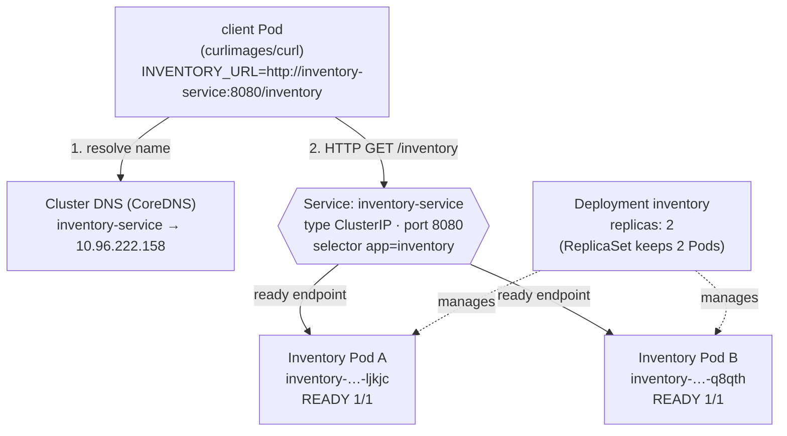
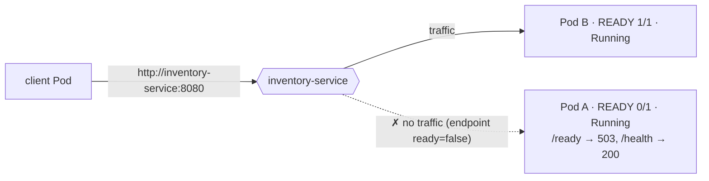

# Kubernetes Service Discovery, Readiness & Pod Recovery Lab

## Overview

This repository deploys a small **Inventory** HTTP service on Kubernetes (kind) and demonstrates three things:

| # | Demonstration | Result |
|---|---|---|
| 1 | **Service discovery and load distribution.** One client calls `http://inventory-service:8080`, and requests reach **both** Inventory replicas. | ✅ [Evidence](#demonstrate-traffic-across-both-replicas) |
| 2 | **Readiness.** One Pod is made unready but stays `Running`. The Service stops sending it traffic, and once readiness is restored it receives traffic again. | ✅ [Evidence](#readiness-probe-demonstration) |
| 3 | **Pod failure and recovery.** One Pod is deleted, and the Deployment creates a new Pod with a new name. The Service name and ClusterIP stay the same and the client keeps working. | ✅ [Evidence](#pod-failure-and-recovery) |

What is deployed:

* **Deployment `inventory`**: exactly **2 replicas**, with a readiness probe on `/ready` and a liveness probe on `/health`.
* **Service `inventory-service`**: a `ClusterIP` Service on port 8080 that selects `app=inventory`.
* **Pod `client`**: exactly **1 client**. It calls only `http://inventory-service:8080/inventory` and never uses a Pod IP.

Every Inventory response includes the **name of the Pod that handled it** (`"pod": "<pod-name>"`). This is how the evidence below proves which replica served each request.

> All terminal output in this README is **real output** from `scripts/setup.sh` and `scripts/run-demo.sh`, run on a kind cluster (Kubernetes v1.37.0, Docker Desktop on macOS arm64). The unedited full transcript is in [`evidence/demo-output.txt`](evidence/demo-output.txt) and [`evidence/setup-output.txt`](evidence/setup-output.txt). Pod names and IPs will differ when you run it yourself.

---

## Architecture



**While a Pod is unready**, the readiness probe on `/ready` fails, the endpoint is marked `ready=false`, and the Service routes only to the remaining ready Pod. The unready Pod keeps running and is **not restarted**:



Plain-text version of the same architecture:

```
            client Pod  (exactly 1)
                 │  HTTP  http://inventory-service:8080/inventory
                 ▼
     ┌──────────────────────────────┐
     │ Service: inventory-service   │  stable DNS name + ClusterIP
     │ selector: app=inventory      │  routes only to READY Pods
     └──────────────┬───────────────┘
           ┌────────┴────────┐
           ▼                 ▼
   Inventory Pod A     Inventory Pod B     ◄── Deployment "inventory", replicas: 2
   READY 1/1           READY 1/1
```

---

## Repository Structure

```
.
├── app/
│   ├── server.py                  # Inventory HTTP service (Python standard library only)
│   ├── Dockerfile                 # python:3.12-alpine + curl, non-root user
│   └── .dockerignore
├── k8s/
│   ├── inventory-deployment.yaml  # Deployment: 2 replicas, readiness + liveness probes
│   ├── inventory-service.yaml     # ClusterIP Service "inventory-service"
│   └── client.yaml                # The single client Pod (calls the Service by name)
├── scripts/
│   ├── setup.sh                   # create kind cluster → build image → load into kind → deploy
│   ├── run-demo.sh                # runs every demonstration with self-checks and saves the evidence
│   └── cleanup.sh                 # delete the resources (optionally the cluster)
├── evidence/
│   ├── setup-output.txt           # real output of scripts/setup.sh
│   └── demo-output.txt            # real output of scripts/run-demo.sh
└── README.md
```

---

## Prerequisites

The Kubernetes environment used is **kind** (Kubernetes in Docker). All commands below are for kind.

| Tool | Version used | Install (macOS) |
|---|---|---|
| Docker Desktop | 28.5.1 | https://www.docker.com/products/docker-desktop/ (must be running) |
| kind | v0.33.0 | `brew install kind` |
| kubectl | v1.34.1 | `brew install kubectl` |

> kubectl prints a version-skew warning against the v1.37 kind node. It is harmless for every command used in this lab.

---

## Application Endpoints

`app/server.py` listens on port **8080**.

| Method | Path | Purpose | Response |
|---|---|---|---|
| GET | `/` or `/inventory` | Normal application endpoint | `200` JSON with `service`, **`pod`**, `pod_ip`, `node`, `message`, `items` |
| GET | `/health` | Liveness probe. Reports only whether the process is alive. **Not** affected by readiness. | `200` |
| GET | `/ready` | Readiness probe | `200` when ready, **`503`** after `/readiness/fail` |
| POST | `/readiness/fail` | Makes **this Pod** report not-ready. The process keeps running. | `200` |
| POST | `/readiness/restore` | Makes **this Pod** report ready again | `200` |

Example response from `/inventory`:

```json
{"service": "inventory", "pod": "inventory-768b4699c8-q8qth", "pod_ip": "10.244.0.11", "node": "inventory-lab-control-plane", "message": "Inventory request handled successfully", "items": [{"sku": "SKU-1001", "name": "Keyboard", "quantity": 42}, ...]}
```

`pod`, `pod_ip` and `node` are injected through the Kubernetes **Downward API** (`metadata.name`, `status.podIP`, `spec.nodeName`), so each replica reports its own identity.

**Readiness vs. liveness.** The readiness flag is held in memory, and `/readiness/fail` changes only what `/ready` returns. `/health` (the liveness probe) always returns 200 while the process is alive. Failing readiness therefore removes the Pod from Service traffic, but Kubernetes never restarts it.

---

## Build the Inventory Image

kind nodes cannot see images in your local Docker daemon, so the image is built locally and then **loaded into the kind node**. The Deployment uses `image: inventory:1.0` with `imagePullPolicy: IfNotPresent`, so Kubernetes uses the loaded image and does not pull from a registry.

```bash
kind create cluster --name inventory-lab --wait 120s
kubectl config use-context kind-inventory-lab

docker build -t inventory:1.0 app/
kind load docker-image inventory:1.0 --name inventory-lab
```

## Deploy

```bash
kubectl apply -f k8s/
kubectl rollout status deployment/inventory --timeout=120s
kubectl wait --for=condition=Ready pod/client --timeout=120s
```

**Shortcut:** `./scripts/setup.sh` runs every command in the two sections above. After that, run `./scripts/run-demo.sh` to repeat **all** demonstrations below. The demo script finds Pod names through the label `app=inventory` (none are hard-coded), checks every expected outcome, and exits non-zero if any check fails.

Real output of the deploy step (from [`evidence/setup-output.txt`](evidence/setup-output.txt)):

```
pod/client created
deployment.apps/inventory created
service/inventory-service created
Waiting for deployment "inventory" rollout to finish: 0 of 2 updated replicas are available...
Waiting for deployment "inventory" rollout to finish: 1 of 2 updated replicas are available...
deployment "inventory" successfully rolled out
pod/client condition met
```

---

## Verify Deployment

```
$ kubectl get deployments -o wide
NAME        READY   UP-TO-DATE   AVAILABLE   AGE   CONTAINERS   IMAGES          SELECTOR
inventory   2/2     2            2           4s    inventory    inventory:1.0   app=inventory

$ kubectl get pods -o wide
NAME                         READY   STATUS    RESTARTS   AGE   IP            NODE                          NOMINATED NODE   READINESS GATES
client                       1/1     Running   0          4s    10.244.0.10   inventory-lab-control-plane   <none>           <none>
inventory-768b4699c8-ljkjc   1/1     Running   0          4s    10.244.0.12   inventory-lab-control-plane   <none>           <none>
inventory-768b4699c8-q8qth   1/1     Running   0          4s    10.244.0.11   inventory-lab-control-plane   <none>           <none>

$ kubectl get service inventory-service -o wide
NAME                TYPE        CLUSTER-IP      EXTERNAL-IP   PORT(S)    AGE   SELECTOR
inventory-service   ClusterIP   10.96.222.158   <none>        8080/TCP   4s    app=inventory

$ kubectl get endpointslices -l kubernetes.io/service-name=inventory-service
NAME                      ADDRESSTYPE   PORTS   ENDPOINTS                 AGE
inventory-service-nq6gr   IPv4          8080    10.244.0.12,10.244.0.11   4s
```

* Deployment `inventory` shows **2/2** ready replicas.
* Both Inventory Pods are **`1/1 Running`**, and there is exactly **one** `client` Pod.
* Service `inventory-service` uses selector `app=inventory`, and its EndpointSlice lists **both** Pod IPs.

---

## Verify Kubernetes Service Discovery

The client is configured **only** with the Service DNS name ([`k8s/client.yaml`](k8s/client.yaml)):

```
$ kubectl get pod client -o jsonpath='{.spec.containers[0].env}'; echo
[{"name":"INVENTORY_URL","value":"http://inventory-service:8080/inventory"}]
```

Cluster DNS resolves the Service name to the Service's **ClusterIP** (`10.96.222.158`). It does not resolve to a Pod IP:

```
$ kubectl exec client -- nslookup inventory-service.default.svc.cluster.local
Server:		10.96.0.10
Address:	10.96.0.10:53

Name:	inventory-service.default.svc.cluster.local
Address: 10.96.222.158
```

A verbose request from the client using the short name `inventory-service`:

```
$ kubectl exec client -- curl -sv http://inventory-service:8080/inventory 2>&1 | grep -E 'Connected to|"pod"' | sed 's/, "items".*//'
* Connected to inventory-service (10.96.222.158) port 8080
{"service": "inventory", "pod": "inventory-768b4699c8-q8qth", "pod_ip": "10.244.0.11", "node": "inventory-lab-control-plane", "message": "Inventory request handled successfully"

Service ClusterIP: 10.96.222.158
Inventory Pod IPs: 10.244.0.12 10.244.0.11
```

**Why this proves DNS-based discovery.** curl was given only the name `inventory-service` and connected to `10.96.222.158`, which is the Service ClusterIP. That address belongs to neither Inventory Pod (`10.244.0.11` and `10.244.0.12`). kube-proxy then forwarded the connection to a ready backend Pod. The client never knows or uses Pod IPs.

---

## Demonstrate Traffic Across Both Replicas

The command sends 20 requests, all to `http://inventory-service:8080/inventory`. Each `curl` runs as a separate process and opens a **new TCP connection**, so kube-proxy picks a backend independently for each request.

```
$ kubectl exec client -- sh -c 'for i in $(seq 1 20); do printf "request %02d -> " $i; curl -s http://inventory-service:8080/inventory | grep -o "\"pod\": \"[^\"]*\""; done'
request 01 -> "pod": "inventory-768b4699c8-ljkjc"
request 02 -> "pod": "inventory-768b4699c8-q8qth"
request 03 -> "pod": "inventory-768b4699c8-ljkjc"
request 04 -> "pod": "inventory-768b4699c8-ljkjc"
request 05 -> "pod": "inventory-768b4699c8-ljkjc"
request 06 -> "pod": "inventory-768b4699c8-ljkjc"
request 07 -> "pod": "inventory-768b4699c8-ljkjc"
request 08 -> "pod": "inventory-768b4699c8-q8qth"
request 09 -> "pod": "inventory-768b4699c8-ljkjc"
request 10 -> "pod": "inventory-768b4699c8-q8qth"
request 11 -> "pod": "inventory-768b4699c8-q8qth"
request 12 -> "pod": "inventory-768b4699c8-ljkjc"
request 13 -> "pod": "inventory-768b4699c8-ljkjc"
request 14 -> "pod": "inventory-768b4699c8-ljkjc"
request 15 -> "pod": "inventory-768b4699c8-q8qth"
request 16 -> "pod": "inventory-768b4699c8-ljkjc"
request 17 -> "pod": "inventory-768b4699c8-ljkjc"
request 18 -> "pod": "inventory-768b4699c8-ljkjc"
request 19 -> "pod": "inventory-768b4699c8-q8qth"
request 20 -> "pod": "inventory-768b4699c8-q8qth"

Requests handled per Pod:
  13 inventory-768b4699c8-ljkjc
   7 inventory-768b4699c8-q8qth
```

**Result.** All 20 requests went to one address, the Service, yet responses came from **two different Pods**: `inventory-768b4699c8-ljkjc` (13 requests) and `inventory-768b4699c8-q8qth` (7 requests). The Service is load-balancing across both replicas.

> Kubernetes does **not** guarantee round-robin. kube-proxy (iptables mode here) picks a ready backend at random for each new connection, so the split is uneven (13/7) and varies between runs. The point is that repeated requests reach both replicas. A client that reuses one keep-alive connection would keep hitting the same Pod, which is why every request above opens a new connection.

---

## Readiness Probe Demonstration

The readiness probe from [`k8s/inventory-deployment.yaml`](k8s/inventory-deployment.yaml):

```yaml
readinessProbe:
  httpGet:
    path: /ready
    port: http          # 8080
  initialDelaySeconds: 2
  periodSeconds: 2      # probe every 2 s
  timeoutSeconds: 1
  successThreshold: 1
  failureThreshold: 1   # one failed probe marks the Pod NotReady
```

The short period and threshold make each transition take about 2 seconds, which keeps the demo quick and repeatable. The pod used below is **Pod A = `inventory-768b4699c8-ljkjc`**.

### Before Failure

```
$ kubectl get pods -l app=inventory -o wide
NAME                         READY   STATUS    RESTARTS   AGE   IP            NODE                          NOMINATED NODE   READINESS GATES
inventory-768b4699c8-ljkjc   1/1     Running   0          6s    10.244.0.12   inventory-lab-control-plane   <none>           <none>
inventory-768b4699c8-q8qth   1/1     Running   0          6s    10.244.0.11   inventory-lab-control-plane   <none>           <none>

$ kubectl get endpointslices -l kubernetes.io/service-name=inventory-service -o jsonpath='{range .items[*].endpoints[*]}{.targetRef.name}{"  ip="}{.addresses[0]}{"  ready="}{.conditions.ready}{"\n"}{end}'
inventory-768b4699c8-ljkjc  ip=10.244.0.12  ready=true
inventory-768b4699c8-q8qth  ip=10.244.0.11  ready=true
```

Both Pods are `1/1 Running`, and both are ready endpoints of the Service.

### Trigger Failure

Readiness is failed on **only** Pod A, by running `curl` inside that Pod against its own `localhost` (the Inventory image includes `curl`). The Service is not involved, so the request is guaranteed to reach Pod A:

```
$ kubectl exec inventory-768b4699c8-ljkjc -- curl -s -X POST http://localhost:8080/readiness/fail
{"pod": "inventory-768b4699c8-ljkjc", "ready": false}

$ kubectl wait --for=condition=Ready=false pod/inventory-768b4699c8-ljkjc --timeout=30s
pod/inventory-768b4699c8-ljkjc condition met
```

### Verify Pod Is Running but Unready

```
$ kubectl get pods -l app=inventory -o wide
NAME                         READY   STATUS    RESTARTS   AGE   IP            NODE                          NOMINATED NODE   READINESS GATES
inventory-768b4699c8-ljkjc   0/1     Running   0          8s    10.244.0.12   inventory-lab-control-plane   <none>           <none>
inventory-768b4699c8-q8qth   1/1     Running   0          8s    10.244.0.11   inventory-lab-control-plane   <none>           <none>

$ kubectl get pod inventory-768b4699c8-ljkjc -o jsonpath='phase={.status.phase}  ready={.status.containerStatuses[0].ready}  restarts={.status.containerStatuses[0].restartCount}'; echo
phase=Running  ready=false  restarts=0

$ kubectl exec inventory-768b4699c8-ljkjc -- curl -s -o /dev/null -w 'GET /health -> %{http_code}\n' http://localhost:8080/health
GET /health -> 200

$ kubectl exec inventory-768b4699c8-ljkjc -- curl -s -o /dev/null -w 'GET /ready  -> %{http_code}\n' http://localhost:8080/ready
GET /ready  -> 503

$ kubectl get events --field-selector involvedObject.name=inventory-768b4699c8-ljkjc,reason=Unhealthy -o custom-columns=TYPE:.type,REASON:.reason,MESSAGE:.message | head -3
TYPE      REASON      MESSAGE
Warning   Unhealthy   Readiness probe failed: HTTP probe failed with statuscode: 503
```

**Pod A is `0/1 Running` with 0 restarts.** The process is alive (`/health` returns 200, and `kubectl exec` works) but reports not-ready (`/ready` returns 503). The kubelet recorded `Readiness probe failed ... 503`. Pod B is still `1/1 Running`.

### Verify Service Traffic Avoids Unready Pod

```
$ kubectl get endpoints inventory-service -o wide
Warning: v1 Endpoints is deprecated in v1.33+; use discovery.k8s.io/v1 EndpointSlice
NAME                ENDPOINTS          AGE
inventory-service   10.244.0.11:8080   9s

$ kubectl get endpointslices -l kubernetes.io/service-name=inventory-service -o jsonpath='{range .items[*].endpoints[*]}{.targetRef.name}{"  ip="}{.addresses[0]}{"  ready="}{.conditions.ready}{"\n"}{end}'
inventory-768b4699c8-ljkjc  ip=10.244.0.12  ready=false
inventory-768b4699c8-q8qth  ip=10.244.0.11  ready=true
```

The Service's ready endpoints now contain **only Pod B (`10.244.0.11`)**. In the EndpointSlice, Pod A is listed but marked `ready=false`, so kube-proxy does not route to it.

Next, 20 normal requests through the Service while Pod A is unready:

```
$ kubectl exec client -- sh -c 'for i in $(seq 1 20); do printf "request %02d -> " $i; curl -s http://inventory-service:8080/inventory | grep -o "\"pod\": \"[^\"]*\""; done'
request 01 -> "pod": "inventory-768b4699c8-q8qth"
request 02 -> "pod": "inventory-768b4699c8-q8qth"
request 03 -> "pod": "inventory-768b4699c8-q8qth"
request 04 -> "pod": "inventory-768b4699c8-q8qth"
request 05 -> "pod": "inventory-768b4699c8-q8qth"
request 06 -> "pod": "inventory-768b4699c8-q8qth"
request 07 -> "pod": "inventory-768b4699c8-q8qth"
request 08 -> "pod": "inventory-768b4699c8-q8qth"
request 09 -> "pod": "inventory-768b4699c8-q8qth"
request 10 -> "pod": "inventory-768b4699c8-q8qth"
request 11 -> "pod": "inventory-768b4699c8-q8qth"
request 12 -> "pod": "inventory-768b4699c8-q8qth"
request 13 -> "pod": "inventory-768b4699c8-q8qth"
request 14 -> "pod": "inventory-768b4699c8-q8qth"
request 15 -> "pod": "inventory-768b4699c8-q8qth"
request 16 -> "pod": "inventory-768b4699c8-q8qth"
request 17 -> "pod": "inventory-768b4699c8-q8qth"
request 18 -> "pod": "inventory-768b4699c8-q8qth"
request 19 -> "pod": "inventory-768b4699c8-q8qth"
request 20 -> "pod": "inventory-768b4699c8-q8qth"

Requests handled per Pod:
  20 inventory-768b4699c8-q8qth
```

**All 20 of 20 requests were served by Pod B (`q8qth`). The unready Pod A (`ljkjc`) received none, even though it was still Running.** Every request succeeded, so the remaining ready Pod kept serving clients without interruption.

### Restore Readiness

```
$ kubectl exec inventory-768b4699c8-ljkjc -- curl -s -X POST http://localhost:8080/readiness/restore
{"pod": "inventory-768b4699c8-ljkjc", "ready": true}

$ kubectl wait --for=condition=Ready pod/inventory-768b4699c8-ljkjc --timeout=30s
pod/inventory-768b4699c8-ljkjc condition met

$ kubectl get pods -l app=inventory -o wide
NAME                         READY   STATUS    RESTARTS   AGE   IP            NODE                          NOMINATED NODE   READINESS GATES
inventory-768b4699c8-ljkjc   1/1     Running   0          12s   10.244.0.12   inventory-lab-control-plane   <none>           <none>
inventory-768b4699c8-q8qth   1/1     Running   0          12s   10.244.0.11   inventory-lab-control-plane   <none>           <none>

$ kubectl get endpoints inventory-service -o wide
Warning: v1 Endpoints is deprecated in v1.33+; use discovery.k8s.io/v1 EndpointSlice
NAME                ENDPOINTS                           AGE
inventory-service   10.244.0.11:8080,10.244.0.12:8080   12s

$ kubectl get endpointslices -l kubernetes.io/service-name=inventory-service -o jsonpath='{range .items[*].endpoints[*]}{.targetRef.name}{"  ip="}{.addresses[0]}{"  ready="}{.conditions.ready}{"\n"}{end}'
inventory-768b4699c8-ljkjc  ip=10.244.0.12  ready=true
inventory-768b4699c8-q8qth  ip=10.244.0.11  ready=true
```

Pod A is back to **`1/1 Running`**, has the **same name and IP** as before (it was never restarted or replaced), and has returned to the Service's ready endpoints.

### Verify Both Replicas Receive Traffic Again

```
$ kubectl exec client -- sh -c 'for i in $(seq 1 20); do printf "request %02d -> " $i; curl -s http://inventory-service:8080/inventory | grep -o "\"pod\": \"[^\"]*\""; done'
request 01 -> "pod": "inventory-768b4699c8-ljkjc"
request 02 -> "pod": "inventory-768b4699c8-ljkjc"
request 03 -> "pod": "inventory-768b4699c8-q8qth"
request 04 -> "pod": "inventory-768b4699c8-ljkjc"
request 05 -> "pod": "inventory-768b4699c8-q8qth"
request 06 -> "pod": "inventory-768b4699c8-ljkjc"
request 07 -> "pod": "inventory-768b4699c8-ljkjc"
request 08 -> "pod": "inventory-768b4699c8-ljkjc"
request 09 -> "pod": "inventory-768b4699c8-q8qth"
request 10 -> "pod": "inventory-768b4699c8-ljkjc"
request 11 -> "pod": "inventory-768b4699c8-ljkjc"
request 12 -> "pod": "inventory-768b4699c8-q8qth"
request 13 -> "pod": "inventory-768b4699c8-ljkjc"
request 14 -> "pod": "inventory-768b4699c8-ljkjc"
request 15 -> "pod": "inventory-768b4699c8-ljkjc"
request 16 -> "pod": "inventory-768b4699c8-q8qth"
request 17 -> "pod": "inventory-768b4699c8-q8qth"
request 18 -> "pod": "inventory-768b4699c8-ljkjc"
request 19 -> "pod": "inventory-768b4699c8-q8qth"
request 20 -> "pod": "inventory-768b4699c8-q8qth"

Requests handled per Pod:
  12 inventory-768b4699c8-ljkjc
   8 inventory-768b4699c8-q8qth

$ kubectl get pods -l app=inventory -o custom-columns=NAME:.metadata.name,READY:.status.containerStatuses[0].ready,RESTARTS:.status.containerStatuses[0].restartCount
NAME                         READY   RESTARTS
inventory-768b4699c8-ljkjc   true    0
inventory-768b4699c8-q8qth   true    0

$ kubectl logs inventory-768b4699c8-ljkjc | grep -E 'listening|readiness'
2026-10-28T07:02:42Z pod=inventory-768b4699c8-ljkjc listening on :8080 (pod_ip=10.244.0.12, node=inventory-lab-control-plane)
2026-10-28T07:02:45Z pod=inventory-768b4699c8-ljkjc readiness set to FAILING (/ready now returns 503)
2026-10-28T07:02:50Z pod=inventory-768b4699c8-ljkjc readiness RESTORED (/ready now returns 200)
```

**The restored Pod A (`ljkjc`) is receiving Service traffic again** (12 of 20 requests). Its restart count is still **0**. The application log shows one process that started once, failed readiness, and recovered without ever being killed.

---

## Pod Failure and Recovery

### Pods Before Deletion

```
$ kubectl get pods -l app=inventory -o wide
NAME                         READY   STATUS    RESTARTS   AGE   IP            NODE                          NOMINATED NODE   READINESS GATES
inventory-768b4699c8-ljkjc   1/1     Running   0          14s   10.244.0.12   inventory-lab-control-plane   <none>           <none>
inventory-768b4699c8-q8qth   1/1     Running   0          14s   10.244.0.11   inventory-lab-control-plane   <none>           <none>

$ kubectl get service inventory-service -o wide
NAME                TYPE        CLUSTER-IP      EXTERNAL-IP   PORT(S)    AGE   SELECTOR
inventory-service   ClusterIP   10.96.222.158   <none>        8080/TCP   14s   app=inventory
Service identity before: name=inventory-service clusterIP=10.96.222.158 uid=8ea8903a-fef7-41e3-a479-ae5392678cf1
Pod selected for deletion: inventory-768b4699c8-q8qth (10.244.0.11)
```

### Delete One Pod

```
$ kubectl delete pod inventory-768b4699c8-q8qth
pod "inventory-768b4699c8-q8qth" deleted from default namespace

$ kubectl get pods -l app=inventory -o wide
NAME                         READY   STATUS    RESTARTS   AGE   IP            NODE                          NOMINATED NODE   READINESS GATES
inventory-768b4699c8-ljkjc   1/1     Running   0          16s   10.244.0.12   inventory-lab-control-plane   <none>           <none>
inventory-768b4699c8-mzfks   0/1     Running   0          2s    10.244.0.13   inventory-lab-control-plane   <none>           <none>
```

Right after the delete, `q8qth` is gone and a **new** Pod `mzfks`, 2 seconds old, already exists. It is still `0/1` because its readiness probe has not passed yet, so it does not get traffic until it is ready.

### Kubernetes Creates Replacement

```
$ kubectl rollout status deployment/inventory --timeout=120s
Waiting for deployment "inventory" rollout to finish: 1 of 2 updated replicas are available...
deployment "inventory" successfully rolled out

$ kubectl wait --for=condition=Ready pod -l app=inventory --timeout=120s
pod/inventory-768b4699c8-ljkjc condition met
pod/inventory-768b4699c8-mzfks condition met

$ kubectl get pods -l app=inventory -o wide
NAME                         READY   STATUS    RESTARTS   AGE   IP            NODE                          NOMINATED NODE   READINESS GATES
inventory-768b4699c8-ljkjc   1/1     Running   0          18s   10.244.0.12   inventory-lab-control-plane   <none>           <none>
inventory-768b4699c8-mzfks   1/1     Running   0          4s    10.244.0.13   inventory-lab-control-plane   <none>           <none>

$ kubectl get deployment inventory
NAME        READY   UP-TO-DATE   AVAILABLE   AGE
inventory   2/2     2            2           18s

$ kubectl get events --field-selector involvedObject.name=inventory-768b4699c8,reason=SuccessfulCreate --sort-by=.lastTimestamp -o custom-columns=REASON:.reason,OBJECT:.involvedObject.name,MESSAGE:.message | tail -1
SuccessfulCreate   inventory-768b4699c8   Created pod: inventory-768b4699c8-mzfks
```

The ReplicaSet `inventory-768b4699c8`, owned by the Deployment, recorded **`Created pod: inventory-768b4699c8-mzfks`**. Kubernetes did **not** bring back the deleted Pod. The ReplicaSet controller saw 1 actual Pod against the desired `replicas: 2`, and **reconciled** by creating a brand-new Pod from the Pod template. The Deployment is back to **2/2**.

### Compare Old and New Pod Identity

```
Pods before deletion : inventory-768b4699c8-ljkjc inventory-768b4699c8-q8qth
Pods after deletion  : inventory-768b4699c8-ljkjc inventory-768b4699c8-mzfks
Deleted Pod          : inventory-768b4699c8-q8qth
Replacement Pod      : inventory-768b4699c8-mzfks (10.244.0.13)

$ kubectl get pod inventory-768b4699c8-q8qth 2>&1 || true
Error from server (NotFound): pods "inventory-768b4699c8-q8qth" not found
```

| | Deleted Pod | Replacement Pod |
|---|---|---|
| Name | `inventory-768b4699c8-q8qth` | `inventory-768b4699c8-mzfks` |
| Pod IP | `10.244.0.11` | `10.244.0.13` |
| Exists now? | No (`NotFound`) | Yes, `1/1 Running` |

The replacement has a **different name and a different IP**. Any client that had hard-coded the old Pod's name or IP would now be broken.

### Verify Service Still Works

```
$ kubectl get service inventory-service -o wide
NAME                TYPE        CLUSTER-IP      EXTERNAL-IP   PORT(S)    AGE   SELECTOR
inventory-service   ClusterIP   10.96.222.158   <none>        8080/TCP   18s   app=inventory
Service identity before: name=inventory-service clusterIP=10.96.222.158 uid=8ea8903a-fef7-41e3-a479-ae5392678cf1
Service identity after : name=inventory-service clusterIP=10.96.222.158 uid=8ea8903a-fef7-41e3-a479-ae5392678cf1

$ kubectl get endpointslices -l kubernetes.io/service-name=inventory-service -o jsonpath='{range .items[*].endpoints[*]}{.targetRef.name}{"  ip="}{.addresses[0]}{"  ready="}{.conditions.ready}{"\n"}{end}'
inventory-768b4699c8-ljkjc  ip=10.244.0.12  ready=true
inventory-768b4699c8-mzfks  ip=10.244.0.13  ready=true
```

The Service **name, ClusterIP (`10.96.222.158`) and UID are identical** before and after the deletion. Only its endpoints changed: the label selector `app=inventory` picked up the new Pod `mzfks` automatically. The client configuration was **not changed**, and the same command against the same URL still works:

```
$ kubectl exec client -- sh -c 'for i in $(seq 1 20); do printf "request %02d -> " $i; curl -s http://inventory-service:8080/inventory | grep -o "\"pod\": \"[^\"]*\""; done'
request 01 -> "pod": "inventory-768b4699c8-ljkjc"
request 02 -> "pod": "inventory-768b4699c8-mzfks"
request 03 -> "pod": "inventory-768b4699c8-ljkjc"
request 04 -> "pod": "inventory-768b4699c8-ljkjc"
request 05 -> "pod": "inventory-768b4699c8-mzfks"
request 06 -> "pod": "inventory-768b4699c8-ljkjc"
request 07 -> "pod": "inventory-768b4699c8-ljkjc"
request 08 -> "pod": "inventory-768b4699c8-mzfks"
request 09 -> "pod": "inventory-768b4699c8-mzfks"
request 10 -> "pod": "inventory-768b4699c8-mzfks"
request 11 -> "pod": "inventory-768b4699c8-ljkjc"
request 12 -> "pod": "inventory-768b4699c8-ljkjc"
request 13 -> "pod": "inventory-768b4699c8-ljkjc"
request 14 -> "pod": "inventory-768b4699c8-ljkjc"
request 15 -> "pod": "inventory-768b4699c8-ljkjc"
request 16 -> "pod": "inventory-768b4699c8-mzfks"
request 17 -> "pod": "inventory-768b4699c8-mzfks"
request 18 -> "pod": "inventory-768b4699c8-mzfks"
request 19 -> "pod": "inventory-768b4699c8-ljkjc"
request 20 -> "pod": "inventory-768b4699c8-mzfks"

Requests handled per Pod:
  11 inventory-768b4699c8-ljkjc
   9 inventory-768b4699c8-mzfks
```

All 20 requests succeeded. The **replacement Pod `mzfks` served 9 of them**, and the deleted Pod `q8qth` served none.

The client's own background loop (one request per second to the same Service URL, set in `client.yaml`) ran the whole time, from before the deletion until after the replacement was ready. No request failed:

```
Pod deleted: inventory-768b4699c8-q8qth   Replacement: inventory-768b4699c8-mzfks

$ kubectl logs client --since-time=2026-10-28T07:02:53Z
07:02:53 "pod": "inventory-768b4699c8-ljkjc"
07:02:54 "pod": "inventory-768b4699c8-ljkjc"
07:02:55 "pod": "inventory-768b4699c8-ljkjc"
07:02:56 "pod": "inventory-768b4699c8-ljkjc"
07:02:57 "pod": "inventory-768b4699c8-mzfks"
07:02:58 "pod": "inventory-768b4699c8-mzfks"
07:03:00 "pod": "inventory-768b4699c8-ljkjc"
07:03:01 "pod": "inventory-768b4699c8-mzfks"
07:03:02 "pod": "inventory-768b4699c8-mzfks"
07:03:03 "pod": "inventory-768b4699c8-mzfks"
07:03:04 "pod": "inventory-768b4699c8-mzfks"
```

(A failed request would appear as `REQUEST FAILED`. None did.)

**Takeaway.** Pods are ephemeral: their names and IPs change when they are replaced. The Service gives the client a **stable DNS name and ClusterIP**, and uses its **label selector** to route to whichever Pods currently match and are ready.

---

## Cleanup

```bash
# Delete the lab resources but keep the cluster
kubectl delete -f k8s/

# Delete the kind cluster too
kind delete cluster --name inventory-lab
```

Equivalent script: `./scripts/cleanup.sh` (resources only) or `./scripts/cleanup.sh --delete-cluster`.

---

## Reflection

**Why is a stable Service name useful when Pods can fail or be replaced?**

Pods are ephemeral: in this lab, deleting `inventory-768b4699c8-q8qth` led Kubernetes to create `inventory-768b4699c8-mzfks`, a Pod with a different name and IP, so any client that hard-coded a Pod address would have broken. A Service gives clients one stable DNS name and virtual IP (`inventory-service` → `10.96.222.158`) that do not change, while its label selector keeps the list of real backends up to date as Pods are created, deleted, or fail readiness checks. This lets the client stay decoupled from the backends: it does not need to find, track, or hard-code Pod identities, and it never has to change its configuration when a Pod is replaced. Together with readiness probes, the stable Service name lets the system stay resilient, because traffic moves to healthy replicas automatically while failed Pods recover or are replaced in the background.
